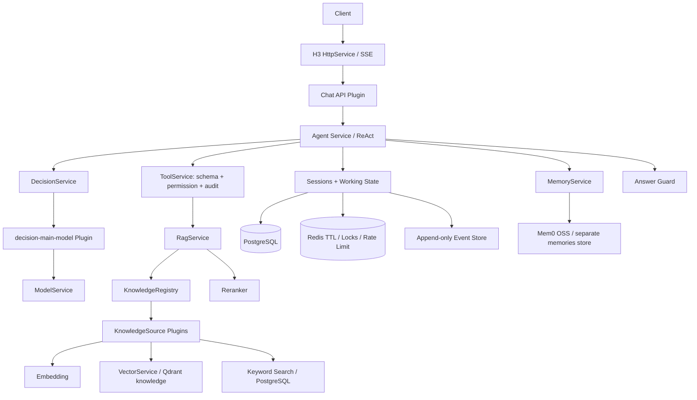

# Ava Agent Harness

以 **Cordis** 为插件内核、自研有限步数 **ReAct Runtime** 为执行核心、**H3** 为 HTTP/SSE Transport 的 TypeScript 客服 Agentic RAG 底座。提供完整默认流程，行业知识、业务工具、决策算法和检索方法可通过插件接入。

Node.js **22.12+**、pnpm、ESM、TypeScript strict；测试使用 **Vitest**，lint 使用 **oxlint**，格式化使用 **oxfmt**。

## 快速运行

```bash
pnpm install
pnpm dev
```

默认 `APP_MODE=mock`，无需数据库、模型密钥或 Docker，监听 `http://127.0.0.1:3000`。**浏览器直接打开此地址即可使用聊天页面**。mock 模式使用真实的 Cordis 插件组合、Agent 循环、工具注册、RAG、上下文构建、Guard 和 SSE；只替换外部 Provider。重启会丢失内存数据。

Web 页面支持发送问题、Markdown 回答、SSE 状态、停止生成、新建/搜索/恢复会话、查看知识引用，以及移动端布局。服务设置展示当前长期记忆和会话存储方式；需要认证时可输入访问 Token，Token 只保留在当前页面内存中。

`pnpm dev` 构建 Harness、共享包和前端后，由 pnpm 监听 Harness、Web、Protocol、SDK、Shared 的变更。需要 Vite HMR 时分别运行 `pnpm dev:harness` 和 `pnpm dev:web`，浏览器打开 `http://127.0.0.1:5173`。

**可视化接入插件：** 点击聊天侧栏“插件管理”，或打开 `http://127.0.0.1:3000/#/plugins`。支持加载独立项目已构建的本地 JS，登记、配置、启停和切换算法 Provider，重启后恢复。操作需要 `admin: true` 且 `managePlugins: true` 的平台 Token。配置权限、项目示例与故障恢复见 [Web 插件管理](docs/plugin-management.md)。

### pnpm monorepo

```text
apps/
  harness/                    # @ava/harness：Agent 运行时与服务端
    src/bootstrap/            # 启动、Cordis Context、插件装配
    src/core/                 # 按领域拆分的接口、类型、核心约束
    src/plugins/              # Provider、知识源、运行时、HTTP/API 实现
    src/config/               # env.ts、schema.ts
    src/prompts/
    tests/
    drizzle/                  # 保留原迁移历史
  web/                        # @ava/web：独立 React 聊天客户端
    src/pages/                # ChatPage
    src/components/           # chat、message、citation、Brand
    src/services/             # SDK → 界面适配
    src/lib/                  # 仅 UI 类型
  admin/                      # @ava/admin：管理端骨架，尚无页面/启动脚本
packages/
  protocol/                   # @ava/protocol：chat、citation、knowledge、error、config
  sdk/                        # @ava/sdk：AgentClient、chat、stream、knowledge
  shared/                     # @ava/shared：公共错误与安全 URL 工具
  config/                     # @ava/config：共用 TypeScript 配置
pnpm-workspace.yaml
ava.config.ts                 # 固定应用装配；dev/start 自动读取对应源/构建配置
extensions/                   # 可选的应用内插件；独立项目不需要放在这里
data/plugins.json             # Web 管理登记与参数，默认不提交
tsconfig.base.json            # 引用 packages/config 中的配置
.env                          # 配置保留在根目录，不提交
```

完整 Harness 内部目录和依赖边界见 [ARCHITECTURE.md](ARCHITECTURE.md)。Web 是独立客户端，使用 `@ava/sdk`，不依赖 Harness 源码。`web-static` 是可选的静态资源托管插件，只托管 Web 构建产物并返回公开配置；它不管理 React 页面或前端生命周期。

每个插件的职责、服务依赖、配置、生命周期与实现限制见 [插件文档索引](apps/harness/src/plugins/README.md)。

开发者接入见 [插件开发文档](docs/plugin-development.md)：通过公开的 `@ava/harness` / `@ava/harness/plugin` 入口装配，不需要修改 bootstrap。`providers` 明确替换实现，`plugins` 追加知识源、工具和行业校验。`pnpm example:retail` 运行独立零售示例：规则决策、订单查询、自定义知识源和答案审核，无需外部基础设施。默认设备资料仅为 mock 演示。

各包独立声明依赖，通过 `workspace:*` 连接。`pnpm build` 按依赖图构建；`pnpm test` 和 `pnpm typecheck` 会先构建共享包。Admin 只预留结构，不参与 dev/build。`packages/ui` 暂未建立，待 Web/Admin 出现实际共用组件后再提取。工具仍使用 Vitest、oxlint、oxfmt，不引入 ESLint 或额外任务调度框架。

```bash
pnpm --filter @ava/harness test
pnpm --filter @ava/protocol test
pnpm --filter @ava/sdk test
pnpm build:harness
pnpm build:web
```

单独运行子包检查前，先运行 `pnpm --filter @ava/sdk... build` 构建共享依赖。原 `dev:server`、`build:server` 根命令保留为 Harness 命令的别名。部署时保留 `apps/harness/dist`、`apps/web/dist`、`packages/protocol/dist`、`packages/shared/dist` 及对应 workspace 依赖；使用根应用配置时还要保留 `.ava/` 构建产物，Web 插件登记文件和独立插件运行依赖也应持久保留。运行 `pnpm start`。仅部署 API 时可以省略 Web 产物。

```bash
curl -N http://localhost:3000/api/v1/chat \
  -H 'Content-Type: application/json' \
  -d '{"conversationId":"conv001","message":"我的 VCD-2000 换完耗材以后一直报 E102，怎么处理？"}'
```

PowerShell 可使用 `curl.exe`，并把 JSON 保存为 UTF-8 文件后通过 `--data-binary @request.json` 发送。`GET /health` 返回服务状态。

演示知识明确标记为虚构样例，其 URL 是占位来源；真实部署需导入经审核的厂家文档。

## 使用真实基础设施

```bash
docker compose up -d
pnpm db:migrate
```

复制 `.env.example` 为 `.env`。仅想使用 mock LLM 联调 PostgreSQL、Redis、Qdrant 时：

```dotenv
APP_MODE=mock
INFRA_MODE=external
QDRANT_COLLECTION=knowledge_mock_64
```

mock Embedding 是 64 维；真实模型默认 1536 维，必须使用不同的 Collection。已有 Collection 的维度不匹配会在启动时失败。

接入真实模型：

```dotenv
APP_MODE=live
LLM_BASE_URL=https://your-openai-compatible-endpoint/v1
LLM_API_KEY=replace-me
LLM_MODEL=your-model
EMBEDDING_BASE_URL=https://your-embedding-endpoint/v1
EMBEDDING_API_KEY=replace-me
EMBEDDING_MODEL=your-embedding-model
EMBEDDING_DIMENSIONS=1536
QDRANT_COLLECTION=knowledge
API_KEYS={"replace-with-a-long-random-token":{"tenantId":"demo","userId":"alice","permissions":["READ","WRITE"],"admin":true}}
```

`live` 自动使用外部基础设施，不允许静默降级到内存或 mock 模型。`production` 强制 `live` 和非空 API Token 配置。密钥应由部署环境注入。后端配置读取集中在 `apps/harness/src/config/index.ts`，无论从根目录还是子包启动都读取根 `.env`；前端的开发代理端口在自己的 `vite.config.ts` 中配置。

请求使用 `Authorization: Bearer <token>`。Token 在服务端映射到租户、用户和工具权限；请求体不能指定这些字段。未配置 Token 的开发 mock 模式使用固定 `demo/demo-user`，只具有 READ 权限。配置 Token 后关闭匿名访问。

Compose 只适用于本地开发：PostgreSQL、Redis、Qdrant 的端口均绑定到 `127.0.0.1`。`docker compose stop` 停止服务并保留数据。

## Architecture



`packages/protocol/src/index.ts` 是前后端共享的 API 契约；`apps/harness/src/core/` 下的领域目录定义后端服务接口；`core/agent` 实现状态和上下文预算，`core/decision` 定义决策接口、输入上下文和严格输出 schema。`apps/harness/src/plugins/*` 提供实现，`apps/harness/src/bootstrap/plugins.ts` 只负责组合。Agent 不导入 H3、OpenAI、PostgreSQL、Redis、Qdrant 或 Mem0 SDK，也不直接调用 `ctx.model`。架构测试约束这些边界。

## Cordis Plugin Design

采用 Cordis `4.0.0-rc.12`，锁定该版本以避免 RC API 漂移；H3 使用明确锁在 v1 主版本的 Node 适配接口。

所有 Provider 声明 `provide`，消费者声明 `inject`。`ctx.provide()` 注册服务，`ctx.effect()` 注册连接、路由、工具等资源的释放函数。Cordis 负责依赖就绪、插件激活、依赖失效和卸载；没有额外 DI 容器或启动顺序调度器。Context 和事件通过 TypeScript declaration merging 扩展。

| 插件                              | 服务/职责                              | 依赖                                                                                   |
| --------------------------------- | -------------------------------------- | -------------------------------------------------------------------------------------- |
| storage-postgres / storage-memory | `ctx.storage`                          | 无                                                                                     |
| cache-redis / cache-memory        | `ctx.cache`                            | 无                                                                                     |
| vector-qdrant / vector-memory     | `ctx.vector`                           | 无                                                                                     |
| model-openai / model-mock         | `ctx.model`                            | telemetry（真实 Provider）                                                             |
| decision-main-model               | `ctx.decision`                         | model, telemetry                                                                       |
| embedding                         | `ctx.embedding`                        | 无                                                                                     |
| reranker                          | `ctx.reranker`                         | 无                                                                                     |
| memory / memory-mem0              | `ctx.memory`                           | storage（内置 Provider）                                                               |
| event-store                       | `ctx.eventStore`                       | storage                                                                                |
| sessions                          | `ctx.sessions`                         | storage, cache, eventStore                                                             |
| tools                             | `ctx.tools`                            | storage, telemetry                                                                     |
| rag                               | `ctx.rag`                              | knowledge, telemetry；可选 reranker                                                    |
| knowledge-tools                   | 注册检索工具                           | tools, rag                                                                             |
| agent-loop                        | `ctx.agent`                            | decision, knowledge, tools, sessions, eventStore, cache, telemetry, guard；可选 memory |
| http-h3                           | `ctx.http`                             | 无 Agent 依赖                                                                          |
| chat-api                          | Chat 路由                              | http, agent, sessions, cache                                                           |
| knowledge-api                     | 导入及轨迹路由                         | http, rag, eventStore                                                                  |
| observability                     | `ctx.telemetry` / typed event listener | 无                                                                                     |

知识源插件通过 `ctx.knowledge` 注册。Qdrant 知识源依赖 vector、embedding、storage、cache 来执行混合检索和发布校验；RAG 仅负责改写、跨来源融合、重排与上下文选择。

## How Agent Works / How ReAct Works

1. 获取会话锁并校验会话所有者，持久化用户消息与初始 checkpoint。
2. 读取近期对话、摘要和用户范围内的长期记忆。
3. Runtime 将当前任务、权限范围内的工具目录、知识源目录、近期消息、摘要、观察、记忆、检索文档和取消信号交给 `ctx.decision.decide(input, context)`。默认主模型 Provider 通过 ContextBuilder 在预算内构建模型输入。
4. Zod 严格校验决策。工具通过参数校验、服务端权限和审计后执行。
5. 记录 Observation、结构化决策和 checkpoint，进入下一步。
6. Guard 验证引用和基础业务一致性，再持久化并发送答案。

不请求、不持久化、不传输模型完整思维链。模型额外返回 reasoning 字段会被严格 schema 拒绝。默认限制为 8 步、10 次工具调用、3 次 RAG 检索、90 秒运行超时。检索工具的每次调用最多生成 3 个查询变体。

工具列表按当前服务端权限过滤；执行时再次校验。未知工具、参数错误、权限拒绝作为可观察的失败结果交回 Agent，尝试次数仍计入预算。会话锁 TTL 为 120 秒，大于允许的最大运行期限 90 秒；释放使用持有者 Token 校验。

## Decision Service

```text
Agent Runtime → ctx.decision → decision-main-model → ctx.model
```

当前主模型决策本身成为独立 Cordis 插件。`DecisionInput` 包含 message、goal、intent、entities、availableTools、availableKnowledgeSources；`DecisionContext` 包含 run/conversation/step、recentMessages、observations、memory、summary、retrievedDocuments 和 AbortSignal。主模型 Provider 负责上下文构建、schema 开销预算和模型调用；Runtime 不关心 Provider 使用模型还是规则。

决策输出仍为 `tool_call`、`ask_user`、`final_answer`（含引用）。知识检索通过 `tool_call: knowledge_search/case_search` 执行，不另建一条绕过工具权限与审计的 RAG 通道。即使替换为自定义 Provider，Runtime 也会重新用严格 schema 校验结果，拒绝 reasoning 等额外字段，并继续执行 Guard、调用预算、工具权限和轨迹记录。

默认没有新增模型请求，也未新增 Router Model 或 Hybrid fallback。默认装配主模型决策，独立零售示例提供无模型的规则决策；不提供指向尚未实现插件的 `DECISION_PROVIDER=router-model/hybrid` 配置。

添加独立决策模型时，实现 `DecisionService` 并以 Cordis `provide: ['decision']` 声明，通过 `createHarness(config, { providers: { decision: myPlugin } })` 替换默认实现，Agent Loop 无需更改。规则 Provider 可同时设置 `model: false`，无需模型服务；专用模型 Provider 可以使用自己的 ModelService。输入数据为快照，算法不能通过改写输入来更新运行证据和工具授权。粗粒度业务路由（Domain/Tool/Knowledge selection）尚未提供统一接口，路由结果不能授予服务端权限。

链路观测分别记录 `decision.decide` / `decision_latency_ms` 与默认 Provider 的 `model.decision` / `model_latency_ms`，以免把规则决策误记成模型调用。

## How RAG Works

`knowledge_search` / `case_search` → KnowledgeRegistry 选择知识源 → 查询变体（保留原问题，补充上下文提示与故障码）→ tenant + metadata filter → 向量检索 + SQL 关键词检索 → Reciprocal Rank Fusion → 可替换 Reranker → 最多 5 个分片。

第一阶段关键词检索采用参数化 `ILIKE`，不等同于完整 BM25；Reranker 默认 Noop。大规模知识库可替换关键词检索实现并添加真实 Reranker。查询改写是确定性实现；真实模型也可结合 Memory 在工具参数中给出更明确的查询。

导入支持 Markdown/纯文本，按标题、章节、段落组织，超长段落依次按句子、单词拆分，只有不可分割的超长文本才使用长度兜底。分片包含稳定 UUID、原始 documentId、来源和元数据。PDF/OCR/Office Parser 可在导入前作为独立插件扩展。

知识文档采用不可变版本 ID：同 ID 重复导入相同内容是幂等的；修改内容、标题或 metadata 需要新 ID。先 upsert 向量，再事务发布 SQL 文档和分片。检索只返回已经 SQL 发布的分片，导入中断留下的孤立向量不会进入答案；可重试同一导入，后台孤立向量清理可后续加入。

```bash
curl http://localhost:3000/api/v1/knowledge \
  -H 'Authorization: Bearer <admin-token>' -H 'Content-Type: application/json' \
  -d '{"id":"faq-v1","title":"VCD FAQ","content":"# E102\n\n经审核的排查说明","source":"https://docs.example.com/faq","metadata":{"model":"VCD-2000","errorCode":"E102","version":"1"}}'
```

## How Memory Works

| 层                  | 内容                                   | 存储                                                    |
| ------------------- | -------------------------------------- | ------------------------------------------------------- |
| Working Memory      | 当前 AgentState、步骤、Observation     | 进程 + Redis TTL + durable checkpoint                   |
| Conversation Memory | 消息、摘要、Run、Event                 | PostgreSQL；Redis 保存活跃会话                          |
| Long-term Memory    | 用户偏好、稳定事实、设备信息、重要历史 | MemoryService → Mem0 OSS；未启用时使用 storage Provider |
| Knowledge           | FAQ、手册、SOP、故障案例               | PostgreSQL + Qdrant `knowledge`                         |

不会自动把整段对话写进长期记忆。业务层应在明确授权和筛选后调用 `ctx.memory.remember()`；`recall()`、`forget()` 都要求 tenant/user 范围。Agent 只读取 MemoryService，不依赖 Mem0。

达到消息或字节预算阈值后生成有界、滚动的抽取式摘要；不会把用户主张自动升级为 confirmedFacts。后续可用模型摘要 Provider 替换当前压缩策略。

### 为什么没有安装 mem0ai npm 包？

当前采用 `Node Harness → REST → 自托管 Mem0 OSS 服务`，所以 Harness 不必安装 `mem0ai`。`mem0ai` npm 包还提供 `mem0ai/oss`，可以把 OSS Memory 直接嵌入 Node 进程；其 `MemoryClient` 则用于 Mem0 平台客户端。这些是不同的接入方式，不能只通过依赖列表判断是否正在使用 Mem0。参见 [Mem0 官方 Node/OSS 配置](https://github.com/mem0ai/mem0/blob/main/docs/open-source/configuration.mdx)。

**默认 `MEM0_ENABLED=false`，当前实际使用内置 storage Memory Provider，并未运行 Mem0。** 现有适配器已通过本地 HTTP 协议测试；真实 Mem0 需要先独立部署、配置模型与向量存储，再进行联调。页面中的“连接与服务”会显示实际选择的 Provider，而不会把“已配置”显示为“连通性已验证”。

Mem0 使用独立部署的 **OSS REST Server**，在 `.env` 设置：

```dotenv
MEM0_ENABLED=true
MEM0_URL=http://localhost:8888
MEM0_API_KEY=your-self-hosted-api-key
```

适配器调用 `/memories`、`/search`、`/memories/{id}`，采用 `X-API-Key`；检索使用 `filters.user_id` 和 `top_k`。租户与用户组合编码到 Mem0 user_id；删除前核对所有者。Mem0 的向量存储由其自身服务配置管理；若使用 Qdrant，必须使用独立 `memories` Collection，不能指向本项目的 `knowledge`。Mem0 不在基础 Compose 中，部署见 [Mem0 OSS REST 文档](https://github.com/mem0ai/mem0/blob/main/docs/open-source/features/rest-api.mdx)。

## Context Builder

优先级为：System Rules + 工具定义 + 当前请求 → 最新 Tool Results → 高相关 RAG → Recent Conversation → Summary → Long-term Memory。按保守 UTF-8 字节上界计费，并预留 JSON schema 与消息包装开销，不依赖特定模型 tokenizer。基础规则与当前请求无法放入时明确拒绝，不静默截断用户请求。

资料放入有标签的 JSON envelope，并通过系统规则标记为不可信。这个隔离和权限检查提供基础防护，Guard 目前验证的是引用真实性和基础动作一致性，尚未实现通用的逐句事实蕴含验证。

## How Event Store Works

`agent_events` 保存 append-only trajectory；数据库 trigger 拒绝 UPDATE/DELETE。消息、决策、工具调用/结果、RAG、记忆读取、错误和状态 checkpoint 都可追踪。事件具有单调数据库 sequence，回放按该顺序读取。

`ctx.eventStore.replay(runId, tenantId)` 返回轨迹；`recover()` 用 Zod 校验最后一个 checkpoint 后返回状态，可用于调试、评估、恢复决策。恢复不会自动重放有副作用的工具。生产接入工单/设备写操作时，Provider 必须实现幂等键及业务系统结果核对，才能安全自动续跑。

```bash
curl http://localhost:3000/api/v1/runs/replay \
  -H 'Authorization: Bearer <admin-token>' -H 'Content-Type: application/json' \
  -d '{"runId":"<run-uuid>"}'
```

接口只允许管理员，并限定当前 Token 的租户。会话、消息、Run、Event 适用于持久审计；Redis 只保存临时态。事件/消息的长期归档、隐私删除及运维角色权限应在正式部署策略中定义。

## API / SSE

`GET /api/v1/client-config` 只返回公开 UI 配置（mode、authRequired、memoryProvider、persistence、maxMessageLength），不返回密钥或服务 URL。

`GET /api/v1/conversations` 返回当前用户最近的 100 个会话；`POST /api/v1/conversations/history` 接收 `{ "conversationId": "..." }`，返回最近 100 条消息及持久化引用。列表按 tenant/user 筛选；历史读取再次校验所有者，不存在的会话返回 404。聊天记录不会写入浏览器 localStorage。

`POST /api/v1/chat` 请求体只有 `conversationId` 和 `message`。

事件：`agent.started`、`agent.step`、`tool.started`、`tool.completed`、`rag.started`、`rag.completed`、`answer.delta`、`answer.completed`、`error`；15 秒无输出时发送 `ping`。

身份/输入错误在打开流之前返回 HTTP 4xx；流中的执行错误通过 `error` 事件返回。客户端断连触发 AbortSignal，Provider 和循环响应取消。SSE 当前不支持 Last-Event-ID 续传；持久轨迹另由 Event Store 查询。

为避免无效或越权内容提前外泄，**完整答案通过 Guard 后才切分为 answer.delta**。这些增量是经过校验的答案传输，不是模型生成 token 的实时透传。独立 ModelService.stream 已提供真实模型流接口。

## How to Add a Tool

```ts
import type { Context } from '@ava/harness/plugin';
import { z } from 'zod';

export const myToolPlugin = {
  name: 'my-tool',
  inject: ['tools'],
  apply(ctx: Context) {
    ctx.effect(() =>
      ctx.tools.register({
        name: 'lookup_order',
        description: '查询当前用户的订单',
        permission: 'READ',
        inputSchema: z.object({ orderId: z.string() }).strict(),
        async execute(input, context) {
          // 在业务 Provider 内检查 context.principal 对该订单的对象级权限。
          context.signal.throwIfAborted();
          return { orderId: input.orderId, status: 'pending' };
        },
      }),
    );
  },
};
```

通过 `createHarness(config, { plugins: [myToolPlugin] })` 注册，无需修改 Agent。默认 mock 模式装配五个显式 `mock: true` 的演示业务工具，可用 `demoTools: false` 关闭；live 模式不装配这些工具。真实业务插件需自行连接外部系统并校验对象归属。自定义检索工具声明 `kind: 'retrieval'`，受统一检索预算限制。

## How to Add a Model Provider

实现 `ModelService.chat/stream/structuredOutput`，插件 `provide: ['model']`，使用 `ctx.provide('model', implementation)`，通过 `providers.model` 替换默认实现。必须保留输出 schema 校验、请求取消和超时；不能将模型原始 reasoning 内容传入轨迹。

## How to Add a Memory Provider

实现 `MemoryService.remember/recall/forget` 并提供 `memory`；强制 tenant/user 隔离，注册连接释放函数。可替换为 Zep 或自定义存储，Agent 无需修改。

## How to Add a Knowledge Source

从 `@ava/harness/plugin` 导入 `KnowledgeSource` 类型，在新的 Cordis 插件中声明 `inject: ['knowledge']`，使用 `ctx.effect(() => ctx.knowledge.register(source))` 注册，再放入 `options.plugins`。默认参与检索；只供特定工具使用的来源设 `default: false`。可通过 `knowledge_search` 的 `sources` 参数选择注册名称。案例工具固定选择 `cases` 来源。

来源负责实际数据访问、对象级权限、metadata filter、全局唯一分片 ID；Registry 再次检查租户边界。外部来源不需要写入本地 PostgreSQL。Qdrant 来源保留原 SQL 发布检查，避免中断导入的孤立向量进入答案。新来源无需修改 Agent Runtime。

## TypeScript SDK

```ts
import { AgentClient } from '@ava/sdk';

const client = new AgentClient({ baseURL: 'http://localhost:3000', token: 'your-token' });
for await (const event of client.chat.stream({
  conversationId: 'conv001',
  message: 'VCD-2000 E102 怎么处理？',
})) {
  if (event.type === 'answer.delta') process.stdout.write(event.data.text);
}
```

SDK 同时提供 `config()`、`conversations()`、`history()`、`knowledge.ingest()` 和 `plugins.list/install/action/configure()`，支持 AbortSignal。身份由 Token 决定，管理接口仍由 Harness 校验对应权限。HTTP 错误与 SSE error 抛出异常；缺失 answer.completed 被视为流中断。

## How to Add a Vector Store

实现 `VectorService.search/upsert/delete` 并提供 `vector`，通过 `providers.vector` 替换。必须在服务端存储层执行 tenant 与 metadata filter，并校验 Embedding 维度。RAG 不导入 Provider SDK。

## How to Add an API Plugin

声明 `inject: ['http', ...业务服务]`，通过 `ctx.effect(() => ctx.http.post(path, handler))` 注册路由。只使用抽象 HttpRequest/HttpResponse，不能直接导入 H3。新增同进程 CLI 可调用 AgentService；独立客户端通过 `@ava/sdk` 调用 HTTP/SSE。

## Observability

结构化日志包括 run_id、conversation_id、事件、步骤、模型延迟、真实 Provider 返回的 token usage 和错误码。OpenTelemetry span 覆盖 Agent、模型决策、工具、RAG；启用 `OTEL_ENABLED=true` 后将 trace 导出至 OTLP/HTTP Collector，日志包含 trace_id。默认关闭外部导出。

## 数据库与验证

Drizzle schema 和 migration 覆盖 users、conversations、messages、conversation_summaries、agent_runs、agent_events、knowledge_documents、knowledge_chunks、tool_audit_logs、long_term_memories。Schema 修改后运行 `pnpm db:generate` 并审查 SQL，再执行 `pnpm db:migrate`。

```bash
pnpm lint          # oxlint
pnpm format        # oxfmt 写入格式化
pnpm format:check  # oxfmt 只检查
pnpm typecheck
pnpm test          # Vitest，无外部依赖
pnpm build
pnpm start

# 真实 PostgreSQL / Redis / Qdrant，不调用外部 LLM
docker compose up -d
pnpm db:migrate
pnpm test:integration
```

测试覆盖 Agent 正常路径与上限、工具权限和参数、混合检索与发布失败、Memory 隔离、轨迹回放、Context Budget、HTTP/SSE、Provider 协议和 Cordis 卸载。真实模型与 Mem0 的协议测试使用本地 HTTP fixture，不消耗真实模型额度。集成测试使用独立租户和 `knowledge_integration_64` Collection，并保留轨迹供排查。

可扩展方向：业务 Provider 的幂等和人工审批、真实 Reranker、BM25、文档 Parser、知识版本发布管理、模型评估集、SSE 续传和自动恢复策略。现有核心接口允许这些能力以插件方式加入。

参考：[Cordis 官方源码](https://github.com/cordiverse/cordis)、[H3 v1 SSE](https://v1.h3.dev/guide/websocket)、[Oxlint](https://oxc.rs/docs/guide/usage/linter/config)、[Oxfmt](https://oxc.rs/docs/guide/usage/formatter/config)。
