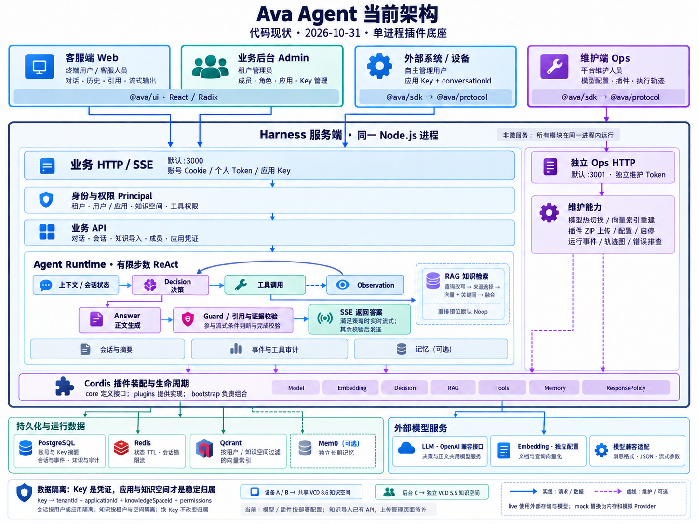

# 当前架构总览

图片描述架构的逻辑关系，端口为默认值。各部署可按需启用可选服务。

## 三个端与外部接入

| 入口           | 对象               | 当前职责                                          |
| -------------- | ------------------ | ------------------------------------------------- |
| Web            | 终端用户、客服人员 | 登录、流式对话、历史、引用、删除会话              |
| Admin          | 租户管理员         | 成员角色与启停、应用、Key 签发与撤销              |
| Ops            | 平台维护人员       | 模型配置、索引重建、插件上传与启停、执行轨迹      |
| 外部系统或设备 | 接入方系统         | 使用应用 Key 调用 API，自主管理最终用户与会话映射 |

Web、Admin、Ops 使用 SDK 与共享 API 契约；三端共用 `@ava/ui`。外部系统也可以直接调用 HTTP，不强制使用 SDK。

## 运行边界

Harness 是一个 Node.js 进程内的插件底座。业务 HTTP/SSE 默认监听 3000；Ops 默认监听 3001，使用独立维护凭证，不能由业务账号或应用 Key 获得权限。Admin 与 Web 同源，`/admin/` 不是独立后台服务。

Cordis 管理服务依赖、插件装配和释放。`core` 定义领域接口与约束，`plugins` 提供实现，`bootstrap` 负责组合；图中的插件装配带不是每次请求必须顺序经过的一层。

Agent 循环管理上下文、预算、工具权限、观察结果和轨迹。默认 Decision Provider 使用模型进行决策；知识检索作为工具进入 RAG，返回结果后可再次决策。live 模式默认启用 `ANSWER_STREAMING`，由 AnswerService 单独生成正文。回答策略允许流式、没有附加审核且本次未调用非检索工具时，Guard 先校验证据与引用，正文随后实时发送。其他路径先生成完整答案并通过 Guard，再以 SSE 发送。

## 身份和数据归属

- Key 是凭证，绑定稳定的 `tenantId + applicationId + knowledgeSpaceId` 与权限；轮换不改变知识、会话归属。
- 会话按租户及用户或应用隔离；接入方负责同一应用内最终用户与会话的授权关系。
- 知识按租户和知识空间隔离。设备 A/B 可以共用 VCD 8.6 空间，后台 C 可以独立绑定 VCD 5.5 空间；共享知识不共享应用会话。
- 应用 Key 不召回个人用户维度的长期记忆。Mem0 是可选 Provider，默认还有内置存储记忆实现。

## 当前实现范围

live 默认使用 PostgreSQL、Redis、Qdrant 和独立配置的 LLM/Embedding 服务。mock 默认替换为内存和模拟 Provider，也可显式接外部基础设施。LLM 同时承担默认决策和正文生成，不要求额外部署一个决策模型。

模型与插件仍按部署配置，尚不是每个应用一套。Reranker 已有替换槽位，默认实现是 Noop。知识导入已有 API，知识文件上传管理页面、SSO、自助租户开通尚未实现。图中没有把这些规划画成现有模块。

## 核对依据与图片生成

- [插件装配](../apps/harness/src/bootstrap/plugins.ts)、[Agent 循环](../apps/harness/src/plugins/agent-loop/react-loop.ts)
- [应用 Key 与知识空间](application-access.md)、[本地身份与角色](local-identity.md)
- [模型配置](model-settings.md)、[插件维护](plugin-management.md)
- [共享 UI](../packages/ui/README.md)

图片使用内置 imagegen 生成，并针对工具到 RAG 的连接做了一次定向校正。[生成提示词](diagrams/current-architecture.prompt.md)保留了布局要求和核对后的模块说明。
